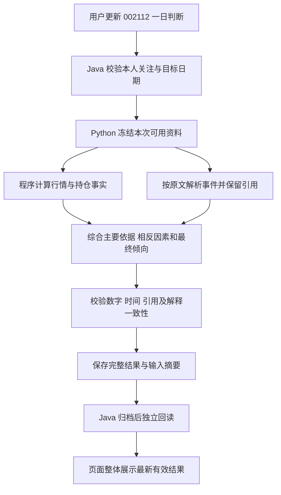

# 002112 一日综合分析实施方案与验收

日期：2026-10-09。状态：已实施并接入本地页面。仅 002112 一日真实运行通过，实际证据、检查范围及剩余限制见第 17 节；不表示预测可靠性已经验证或政策、新闻已完整取得。

业务目标以[需求说明](../requirements/fund-002112-one-day-information-analysis-2026-10-09.md)为准。实施范围仅限 002112、一日；不开展其他基金的真实分析验证，不修改五日、二十日和半年预测。

## 1. 实施结论与关键决策

采用“冻结本次资料 → 计算事实 → 理解事件 → 综合判断 → 校验并整体保存 → 页面读取”的链路。大模型负责内容理解与综合表达，程序负责身份、时间、计算、引用、去重和留档。第一阶段不重新拟合旧分类器，也不训练新的基础大模型。

| 决策 | 实施规则 |
| --- | --- |
| 一个判断来源 | 新结论与主要依据在同一次综合分析中生成；不能让旧分类器定方向、另一个模型补原因 |
| 新结果类别 | 使用独立协议 DIRECTION_1D_ANALYSIS_V1；旧 V1/V2 模型和原验证门槛保留，不能伪造通过标记 |
| 单一方向 | 成功结果有一条 PRIMARY 分析，方向 UP 或 DOWN；不生成两份相同的 FIXED/WEEKLY 假分支 |
| 不伪造概率 | score、upProbability 等保持空；把握为 LOW，页面表达“把握较低”，并附具体原因 |
| 保留旧档 | 新结果独立编号、版本、输入摘要；原预测、原说明和实验产物不覆盖 |
| 只替换页面引用 | 同目标日新结果核对成功后才整体替换页面当前引用；版本历史只在后台保留 |
| 保持手动 | 复用手动更新入口，不新增或恢复调度；打开页面及展开依据不触发采集、训练或收费生成 |
| 先跑通再优化 | 先验收数据、内容、时间和真实链路；后续方向效果独立记录，不把工程通过称作预测有效 |

这些规则替代 002112 新综合分析对“必须有同方向新闻”和“未通过旧模型验证一律拒判”的依赖。旧事件模型文档仍描述旧模型，不回改其研究结果或状态。

## 2. 已核对的工程基础

### 2.1 仓库与职责

| 仓库 | 职责 |
| --- | --- |
| C:/pythonProject/workSpace06 | 资料整合、事实计算、文本解析、综合判断、公共作业和原始产物 |
| C:/ideaProject/workSpace12 | 登录与关注权限、窗口校验、原结果归档、用户关联、当前引用、实际结果核对 |
| C:/WebStormProject/workSpace05 | 预测卡、历史、依据、资料清单与交互 |

项目已经存在 Python SQLAlchemy/Alembic、Java PostgreSQL/Flyway、Vue 3/TypeScript/Vite。沿用这些工具，不为本功能另建服务、消息平台或前端设计系统。

### 2.2 实施前代码位置及实际限制

| 位置 | 已核对事实 | 实施处理 |
| --- | --- | --- |
| Python app/services/direction_1d_information.py | 专用入口限制 002112；新增文件和数据库新闻中部分 stage/direction 为 UNKNOWN | 保留旧恢复路径，新分析主动解析正文，区分未知的具体原因 |
| Python app/services/direction_1d_events.py | 旧事件模型含方向事件、数量限制和拒判规则 | 不修改冻结模型配方，不直接用其 8 项特征代替内容综合分析 |
| Python app/services/prediction_narrative.py | 根据原记录恢复依据，部分路径只整理文案 | 新协议直接读已保存分析，旧协议继续按原输入解释 |
| Python scripts/fund_002112_information_review.py | 已验证单次资料阅读流程，含人工修正缓存、固定基金和输出目录 | 提取处理思路，改为服务和结构契约；不可直接导入脚本当生产入口 |
| Python app/services/direction_1d_jobs.py | 有持久化队列、请求去重、租约及工作线程 | 接入新协议处理器，复用作业身份和恢复能力，避免新增永久循环 |
| Python app/services/direction_1d_revisions.py | 有输入顺序、去重和截止时刻检查 | 复用顺序原则；长时间外部分析不能占着数据库事务锁 |
| Java direction1d 包 | 现有窗口、权限、归档与回读；校验器硬约束旧协议和两个统计分支 | 增加独立新协议校验和投影视图，不能只改前端或删除旧校验 |
| Vue PredictionEvidenceBody.vue | 展示原叙述并调用 narrative；有请求序列保护 | 新协议只渲染保存的结论、事实和影响，不在浏览器临时拼理由 |
| Vue MultiPredictionHistory.vue | 有展开位置补偿，也存在同日版本选择 | 002112 普通页面隐藏同日版本选择，保留后台记录与滚动修复 |

Python 和 Java 现有一日校验仍包含模型、完整净值窗口等前提。新分析需要在相应分派入口提前识别协议，不能先被旧 MODEL_UNAVAILABLE 或缺完整 61 条净值条件拦住，再声称已经接通。

### 2.3 可复用的真实样本

单次分析目录为 Python 仓库的 .local-runs/direction-1d-information/20261009-integrated-review，包含 input.json、各批次原响应、修正响应、综合输入和 analysis-reviewed.json。文件采用 hash/payload 包装，读取时必须核对，不能把外层包装当作业务正文。

它可用于内容解析和展示测试，但不能导入成过去已提前保存的预测。该报告包含人工修正，新服务的独立验收必须产生自身输出，并统计哪些内容仍需要人工介入。

## 3. 处理链路



### 3.1 生成一次判断

1. 浏览器提交现有 generate 请求，只含 expectedTargetDate 和 requestId，不接收用户自报方向、证据、模型或账号。
2. Java 验证权限、002112 路由、数据库时钟和目标窗口；新分析采用自己的数据就绪规则，不借用旧模型发布标记。
3. Python 根据同一截止时刻冻结本次资料和有效持仓映射，分配输入顺序。相同有效输入和分析配置已有成功结果时复用，不再调用外部服务。
4. 保存不可变资料快照，再运行计算和内容理解。分析过程中不偷偷吸收新资料；后续资料只能形成下一次输入。
5. 去重后按内容生成事件对象。净值、行情计算由程序完成，大模型不能自行编数字。
6. 综合阶段一次生成方向、主要依据、相反因素、取舍、改变判断的条件、缺口与低把握说明。
7. 完成结构和引用检查、语义矛盾核对；不能通过的输出保存失败原因，不作为有效预测。
8. 在目标截止前保存完整结果。Java 再校验身份、哈希、时间和新契约，提交后用新事务回读，再更新当前引用。
9. 页面读到同一 recordId 的完整结果，整体刷新。原结论和新依据不会出现交叉组合。

### 3.2 查看依据

新协议的 evidence/narrative 接口只读已保存结果或生成无外部调用的展示投影。不得重新阅读后来新增的消息，也不得再次让大模型润色到改变原义。

旧协议保持原恢复机制。新旧正文按协议分派，不能将旧上升预测包装成新下降分析，也不能用缓存的 10 月 12 日分析填充 10 月 9 日依据。

### 3.3 资料刷新

资料获取继续使用现有手动同步。预测只消费已保存资料；如果现有来源缺相关政策或新闻，在资料清单中显示具体缺口。新增来源、买权限和全市场采集不包含在本阶段。

同步完成不自动启用新的预测调度。用户再次点击现有更新操作时读取新资料；相同消息的转载、无实质变化的目录刷新不应导致重复方向计算。

## 4. 时间与数据契约

### 4.1 统一时间字段

| 字段 | 含义 |
| --- | --- |
| as_of | 本次资料冻结时刻，带时区；只决定当时实际知道什么 |
| target_nav_date | 预测的净值所属交易日 |
| comparison_base_date | 目标日前一交易日，不能因缺净值改为更早日期 |
| deadline_at | 目标交易日 15:00，北京时间 |
| latest_nav_date | 本次实际取得的最新净值日期，可早于 comparison_base_date |
| quote_at / quote_session | 股票或指数行情的实际时刻及交易日，区分盘中和收盘 |
| report_end / published_at | 持仓所属报告期和报告公开时间，不能混用 |
| published_at / first_observed_at | 消息首次公开时刻与本地取得时刻 |
| generated_at / stored_at / verified_at | 分析完成、Java 归档和独立回读时刻，均使用服务端时间 |

生成、归档、核对均需早于 deadline_at，才进入正式提前预测的统计。资料冻结后至完成前发生新的交易窗口变化，不给旧任务修改目标日期。

仅有公开日期而无时刻时，优先以截止前真实取得的原文证明当时可用；没有相应证据不能用于该日盘中回放。历史回放不得把后来下载时间倒填为以前已知。持仓必须在 as_of 前已披露，不能用后来报告的持仓解释过去。

### 4.2 资料包

新增 AnalysisInput 契约，固定 fund_code=002112、horizon_trading_days=1。包括：

- 身份及窗口：上述时间字段、日历版本、资料版本摘要。
- 基金资料：类型、投资范围、比较基准、相关基金事项。
- 净值与计算：原始有效序列、计算窗口、分红调整标记；历史不足只省略相应指标，不伪造 61 条序列。
- 披露持仓：证券代码、名称、权重、权重分母、报告期、披露日期、原件引用。
- 行情与公司事实：行情日期、证券身份、财务期间、单位、公开时间、主营业务出处。
- 文档：来源类型、来源编号、标题、公开时间、原件摘要、正文位置、完整程度、实体映射。
- inventory：需求 D01—D16 的状态、截止时间、已检查范围、实际参与情况及缺口。
- excluded：未来、无关、重复、正文不足等未参与资料及原因，仅用于后台审计和必要的用户缺口提示。

资料取得状态、解析状态、影响方向分别保存：未取得不等于影响中性；双向影响不等于解析失败。输入身份不包含公告条数作为信号，不能用缺失数量代替市场因素。

### 4.3 数值口径

持仓股票估计影响为 Σ(披露权重小数 × 同一交易日股票涨跌小数)，乘以 100 展示为百分点。不把已取得股票权重归一化为 100%，不将未覆盖部分当零收益；同时展示可计算部分占净资产的比例。

该值只描述给定行情日按旧持仓估算的影响，不是基金已公布实际涨跌，更不是目标日涨幅预测。遇复权、除权、停牌、单位或分母不一致时，先校验口径，无法对齐的部分不参与计算。

示例快照同时出现“权益投资占总资产 87.88%”和“股票占净资产 92.60%”，二者分母不同，不能视为矛盾或互相替换。

历史净值和持仓涨跌使用原始精度计算、展示时舍入。零、缺失、四舍五入后显示 0.00% 分开处理。单位净值只是价格水平，不直接代表便宜或昂贵。

### 4.4 输入身份与去重

输入身份包含基金、目标日、协议、日历、有效事实及来源版本、有效事件状态、关联规则、解析与综合规则版本。检查时间变化本身不产生新输入；但事件随交易日变旧、阶段变化或新的有效资料出现，应改变有效输入身份。

采用“原始资料快照摘要”和“有效综合输入摘要”两层记录。相同事件新增转载可以更新资料覆盖审计，不因重复条数再次改变方向。A→B→A 的实际输入变更依照原修订规则产生新顺序，不能因完成时间较晚而覆盖更晚的输入。

## 5. 内容理解与综合判断

### 5.1 解析原文

新增事件解析服务，读取正文与相关表格、上下文。不能只读标题，也不能将董事会、激励、融资等类别整体排除。

每份文件允许提取多个事件，每个事件输出：

| 字段组 | 必需内容 |
| --- | --- |
| 事件身份 | event_id、来源文档集合、事件类别、公司或政策主体、业务对象 |
| 已知事实 | 短引用、页码或段落位置、数值、单位、期间、否定及条件语句 |
| 时间阶段 | 首次公开时间、事件发生或生效时间；拟议、进行中、已实现、历史经营、程序事项或未知 |
| 对象关联 | 直接证券关联、基金自身关联、经证实的行业/业务关联及其依据 |
| 内容含义 | 可能影响收入、成本、现金流、股份供给或风险的路径 |
| 影响 | POSITIVE、NEGATIVE、MIXED、NEUTRAL 或 UNKNOWN；不以 UNKNOWN 替代所有难例 |
| 限制 | 实施条件、原文缺口、时间不明、关联不明等具体原因 |

正文截断或只取得摘要必须显式保存；不能用“已解析”表示读完全文。财务表格引用必须包含能确定数值口径的表头、期间和单位。第一批验收重点包括此前人工修正过的简称、表头、否定和条件信息。

### 5.2 关联与事件归并

- 公司名称、证券代码、历史简称核对后才能建立直接关联；不能只用名称子串。
- 政策不必出现股票名称，但必须有可证明的适用行业/业务和对应持仓业务信息。只有“科技”“基金”等泛词不构成关联。
- 同一事项的董事会决议、具体方案、转载合并为一个事件，保留多个来源；进展更新保存阶段和新增内容。
- 一份公告中融资、投资、人员变更分别建事件；禁止整份文档一个情绪标签代替全部内容。
- 不能把权重、来源可靠性、事件重要性乘成一个声称经过训练的上涨分数。

### 5.3 综合判断产物

综合输入只包含允许的事实和事件，以及本次目标期限。输出至少包括：

- direction：UP 或 DOWN。
- summary：一句当前方向倾向及主要理由。
- main_evidence_ids：主导判断的 1 至 3 条证据引用。
- reasons：通常 3 至 6 条重要依据，资料少可更少，不凑数。
- counterpoints：真实存在的相反因素；没有可核验相反因素时允许空，另说明检索范围，不能编造利好。
- synthesis：为什么这些主要因素相对更重要，如何权衡冲突。
- change_conditions：哪些可观察的新事实会改变当前判断；不得伪造价格点位或交易指令。
- limitations：真实资料缺口、持仓滞后、推断条件。
- confidence：固定 LOW，validation_status 固定 UNVALIDATED，probability 为空。

每条依据的展示对象包括 title、facts、meaning、fund_relation、role、inference、limitations、source_refs。role 区分支持上涨、支持下跌、双向、背景；事实与未来推断必须分开。

净值弱势不能自动生成反弹；负面公告不允许因数量多而变正面。若主要行情偏弱但综合选择上涨，必须指出具体、更强的相反证据及其一日关联，否则判为解释不成立。不能强迫所有单条证据都与最终方向一致。

### 5.4 数据就绪与失败边界

新分析不要求旧统计模型处于已发布状态，不要求存在同方向新闻。最低条件是：基金和目标日确定；资料身份与时间可核验；至少存在与该基金相关、可支持方向推断的有效事实；综合输出能解释取舍。

缺基准日净值不自动阻断，比较基准日保持不变，实际最新净值另列；缺短期历史不伪造趋势指标。只有中性流程文件、无法关联资料或全部来源过期不可用时，返回明确缺口，不随机选方向。

不以纯数量阈值证明资料足够。库存覆盖率、持仓报告年龄、行情缺口和是否遗漏重要事项都需进入质量判断；首版不新增“覆盖 50% 就必然可靠”之类规则。无法确定依据有效性属于内容校验失败，不冒充方向预测成功。

### 5.5 校验和修正

第一层是程序硬检查：字段范围、基金身份、时间、引用存在性、引用在原文中的连续对应、数值单位和计算可复算、URL 协议、正文长度、未来信息与重复事件。

第二层是语义核对：原文是否包含条件或否定；事实是否被夸大；公告阶段是否被改变；经营影响是否被直接写成次日必涨；最终结论是否引用了不存在或相反的主导理由。

大模型复核只是质量控制，不能证明每次推理正确。首批真实样本必须人工逐条核对，问题形成可重现测试；后续才依照已通过的规则自动执行。修正需要新解析/规则版本和新记录，不直接改已保存预测。

综合输出最多进行两次有界修正；公告引用最多修正三个批次，每个批次一次。输入仅包含原事实、原候选及具体校验错误；不能提示“把结果改为上涨”。综合输出仍不通过则失败，保留原有效结果与可读原因。公告批次仍不通过时排除该批、记录缺口，剩余事实重新通过综合校验才可形成判断；当前未实现批内逐文档挽救。

## 6. 接口与结果契约

### 6.1 保留现有浏览器入口

| 入口 | 新分析处理 |
| --- | --- |
| POST /api/v1/watchlist/{fundCode}/prediction-1d/generate | 仅 002112 经开关进入新协议；请求仍只有 expectedTargetDate/requestId，异步受理 |
| GET /api/v1/watchlist/{fundCode}/prediction-1d | 返回当前窗口、同目标日最新有效记录及必要等待/失败状态 |
| GET /api/v1/watchlist/prediction-1d/history | 002112 普通视图按目标日折叠，数据库保留原修订；游标不得漏掉同日最新记录 |
| GET /api/v1/watchlist/{fundCode}/prediction-1d/evidence/{forecastId} | 新协议返回保存的依据、资料清单和时间；旧协议返回原解释 |
| POST /api/v1/watchlist/{fundCode}/prediction-1d/evidence/{forecastId}/narrative | 保留兼容入口；新协议只返回已保存说明，无外部生成 |

内部复用 /internal/v1/direction-1d/forecast-jobs、作业状态、evidence、narrative 和 labels 路由，新增协议分派与校验。浏览器不能直接指定协议、截止时刻、证据正文或大模型参数。

### 6.2 新的完整结果

以下字段为拟定的 Python 原文契约；Java 的页面投影沿用现有 snake_case 到 camelCase 处理，并增加前后端联合测试。

| 字段 | 类型与约束 |
| --- | --- |
| protocol / schema_version | 固定 DIRECTION_1D_ANALYSIS_V1；与旧统计协议区别 |
| fund_code / horizon_trading_days | 固定 002112 / 1 |
| fund_name / cohort_id | 名称来自已核对基金资料；cohort_id 为分析规则版本，长度不超过现有 80 字符限制，不冒充训练批次 |
| target_definition | UNIT_NAV_DIRECTION_THREE_STATE_V2；实际答案仍可 UP/FLAT/DOWN |
| direction_policy | EXACT_UNIT_NAV_CHANGE_V1；比较原始单位净值，不能按显示精度改标签 |
| base_nav_date | 等于 comparison_base_date；不冒充 latest_nav_date |
| target_nav_date、window_open_at、deadline_at、calendar_version | 服务器按交易日历生成，Java 独立核对 |
| as_of、generated_at | 资料冻结及本次成功产物形成时刻，不能取浏览器时间 |
| revision_sequence / input_identity | 原输入先后顺序与有效输入摘要 |
| snapshot_id / snapshot_hash | 不可变资料快照身份 |
| input_hash | 等于 snapshot_hash，供原归档字段保存；与只描述有效判断输入的 input_identity 分开 |
| analysis_version / prompt_hash / engine_id | 规则与模型配置的审计标识，后台保存，不显示在普通页面 |
| validation_status / model_released / up_probability | UNVALIDATED / false / null |
| input_summary | 净值、行情、持仓各自日期，重要覆盖及缺口；原件正文留在受控快照 |
| analysis | 单一 PRIMARY 结果，含上一节综合产物；不伪造训练系数或概率 |
| evidence / inventory | 有界证据对象和 D01—D16 状态；必须能从 analysis 引用到相应对象 |
| source_manifest | 来源编号、版本摘要、可用时间、对象关系，后台保留 |

forecast 作业外层仍使用 payload_json/content_hash，哈希针对完整规范化结果原文。无有效判断时作业返回失败或等待状态及具体原因，不保存 direction=null 的伪成功新分析。

新协议必须有独立的 Java validator 和 TypeScript 判别联合，不能通过给旧对象补几个可选字段假装兼容。旧记录继续使用旧校验器。

首版展示上限：主要依据 6 条、相反因素 4 条、改变判断条件 3 条、局限 5 条；每条最多 5 个来源引用。每个事实段、解释段不超过 400 个中文字符，综合取舍不超过 600 字。超过上限在生成和校验环节处理，不由前端静默截断关键否定与条件。原始证据仍完整留档。原文只展示必要短摘录与链接，遵守既有来源的使用及保留范围。

### 6.3 保存后的一致性

Java 核对 fund_code、source_job_id、目标日、快照身份、原文字节摘要和引用关系。evidence/narrative 返回的 fundCode、recordId、kind 必须与浏览器选中记录相同。

READY 表示该记录说明确实已保存并通过契约检查；PENDING/FAILED 不伪装成功。接口错误只返回必要中文提示；原始模型响应、技术码和原始文档大段正文不下发页面。

## 7. 存储和迁移

### 7.1 复用的存储

| 所属 | 表或原件 | 使用方式 |
| --- | --- | --- |
| Python | direction_1d_job | 持久化 FORECAST 作业，按协议分派；不新建另一套重复任务状态 |
| Python | direction_1d_snapshot | 保存分析资料包；新增独立 kind 的支持及必要约束，不覆盖原快照 |
| Python | direction_1d_input_revision | 保存新协议输入顺序和完整结果；按截止时间一次性完成 |
| Java | direction_1d_forecast | 保存新协议完整原文、摘要和日期；cohort_id 对新协议记录分析规则版本，文档注明其语义 |
| Java | direction_1d_forecast_score | 从 analysis 单独投影为一条 PRIMARY，status=AVAILABLE，predicted_direction 有值，score/model_id/model_hash/train_as_of 为空；不能直接遍历不存在的旧 branches 数组 |
| Java | direction_1d_forecast_receipt、direction_1d_user_forecast | 保留先提交后回读、本人关联及数据范围 |
| Java | direction_1d_current、direction_1d_outcome | 新协议独立当前引用及实际答案；不把新旧协议成绩混算 |

实施前逐项核对表约束和列长度。不能只确认表能存 JSON 就跳过旧查询、触发器、统计和标签校验的协议限制。

### 7.2 新增事件解析缓存

Python 所属数据库已通过 Alembic 20261009_34 新增 fund_analysis_event_parse，没有修改旧迁移。实际字段如下：

| 字段 | PostgreSQL 类型与规则 |
| --- | --- |
| cache_key | char(64) 主键；原件、实际阅读范围、实体上下文、实际提示词和模型配置联合摘要 |
| stage | varchar(16)，区分事件解析、归并、综合、语义核对及修正 |
| state | varchar(16)，RUNNING/READY/FAILED，CHECK 约束；队列状态复用公共作业 |
| payload、content_hash | jsonb/char(64)，READY 必须齐全且匹配；保存原始结构化响应 |
| failure_code | varchar(64)，脱敏业务原因；不存凭据和供应商原始错误 |
| owner_token、lease_until | uuid/timestamptz，控制唯一工作者和中断恢复 |
| attempts、created_at、finished_at | integer/timestamptz，记录调用次数和完成时间 |

唯一键为上述联合摘要 cache_key。同一原件不同截取范围不能共享“全文已读”缓存；公司简称和业务上下文改变也不能复用旧关联结果。READY 后正文不可覆盖；规则变化新增一行。缓存 READY 只表示外部响应成功且已留档，不表示其语义已经通过，使用时仍须执行引用和内容检查。全局缓存只保存公共资料，不包含用户持仓金额或账户信息。

增加失败/租约查找索引；payload 不建无需求的全字段 GIN 索引。全文原件继续沿用现有受控目录与来源保留策略，数据库保留引用、关键事实和摘要；历史查看不得为补失效原件私自重新生成依据。

### 7.3 Java 和数据库一致性

- Java 现有表长度、协议字段及 PRIMARY 分支均可直接兼容，本次没有新增 Flyway migration；不为记录新协议重复改表。
- 当前指针只在结果已提交、哈希正确且回读在截止前成功后更新；相同结果重复归档不新增重复档案。
- 每个协议的修订顺序单独比较；新旧协议的页面优先级由固定 002112 路由策略决定，不能直接比较两者序号。
- 新路径生效后，出现新任务失败，保留同目标日上一条有效记录并明确未更新，不能静默拿旧统计输出冒充本次新分析。
- 目标日改变时按新目标查询，不将上一日结果挂在新日期下。
- 只做增量迁移。回滚关闭路由、恢复旧读路径，保留新表、新结果和原件，不执行 DROP、清表或回写历史。

## 8. 并发 成本与异常

### 8.1 有界执行

实际限额：每次最多选取 100 份文档，每批 4 份；事件修正最多三个批次，综合修正最多两次。事件归并、解析、综合、核对和修正合计最多 28 次实际外部调用，命中已有缓存不扣调用次数。预算不足时有界停止，不保证 100 份全新复杂资料都能在一次任务中读完。单次请求 90 秒上限，整个任务 15 分钟或目标截止时间，以先到者为准。

这些是工程预算，不是预测可靠性门槛。真实接入前记录已有服务用量和耗时；不增加新供应商、套餐或账号权限。任何预算调整在实现配置中留痕，不藏在提示词里。

候选资料超过上限时，先按持仓相关性、时间和是否新事项归并，再确定处理集合，保留未读范围。缺重要内容时不声称已经综合全部资料。长期财务背景独立于近期事件窗口；新阶段的旧事项可以纳入，旧消息不能因今天下载重新变新。

### 8.2 排队与恢复

同一基金/目标日/有效输入仅一个在途分析。先用短事务冻结和登记顺序，再释放锁进行外部调用，避免持有数据库事务或全局锁等待模型响应。

沿用有界工作线程、队列和租约；更新租约只维持用户已发起任务，不启动定期新分析。中断后显式重试复用已完成文档，成功结果不重跑。不为“换一个回答”反复采样。

远程调用超时且是否完成未知时，标记该阶段状态，不立即重发制造重复费用；保留请求记录，按现有服务可核对能力恢复。队列满和预算耗尽均给出实际原因。

### 8.3 状态与页面影响

| 内部情形 | 页面表达 | 是否改变当前结果 |
| --- | --- | --- |
| 排队或分析中 | 正在更新判断，保留上次更新时间 | 否 |
| 缺一类消息但其余分析有效 | 偏上涨/偏下跌，把握较低；列明该类缺口 | 成功后整体更新 |
| 取得但部分解析失败 | 哪部分内容未完成；已用内容边界明确 | 只有剩余证据足以解释方向且校验通过才更新 |
| 正负信息都有 | 说明主要因素和相反因素的取舍 | 可以更新，不能因冲突一律拒判 |
| 没有任何有效方向依据 | 现有资料还不能形成有依据的判断，并说明缺口 | 否 |
| 引用错误或综合输出矛盾 | 本次分析未完成核对，请稍后重试 | 否 |
| 15 点窗口改变或晚完成 | 该预测日期的更新已结束 | 否，不自动改目标 |
| 新目标尚无结果 | 该日期暂无判断 | 不冒用上一目标结果 |

## 9. 安全与可观测性

Java 继续使用会话权限、本人关注范围、Origin/CSRF 和私有缓存控制。详情、依据、原记录 ID 都通过用户关联查询；浏览器不能通过其他用户的 forecastId 读取记录。公共资料计算可去重，个人记录可见性仍独立控制。

Python 内部接口沿用服务鉴权；密钥只从既有配置读取。只向已配置服务发送必要公开资料，不发送账户、持仓金额、交易、Cookie、数据库配置或本地路径。

新闻和公告正文作为不可信数据：原文中的“忽略规则”“调用接口”等内容不得执行。大模型不能触发抓取、系统命令、买卖操作或新增来源。链接只允许现有合法 http/https 来源，前端纯文本渲染，不使用 v-html 展示生成内容；抓取端沿用来源白名单及地址校验。

记录任务开始/完成、输入版本、缓存命中、实际调用次数、耗时、失败分类、引用错误数、事件去重情况和归档回读。日志使用模块方法名及 TraceID；不逐条 INFO 打印原文，不打印密钥或完整请求响应。必要原始响应按现有受控留档保存，不能默认公开给浏览器。

## 10. 文件改造清单

实际文件按以下职责落地；解析、归并和综合在同一服务组织，避免再建重复模块。

| 层 | 新增或修改 | 目的 |
| --- | --- | --- |
| Python 新增 | app/schemas/fund_information_analysis.py | 输入、事件、证据和新结果严格契约 |
| Python 新增 | app/services/fund_information_snapshot.py | 002112 冻结资料、时间过滤、资料清单和有效输入身份 |
| Python 新增 | app/services/fund_information_analysis.py | 原文解析、事件归并、关联、综合判断、核对和完整结果保存 |
| Python 新增 | app/services/fund_information_labels.py | 缺基准日净值时仍保持原比较日期，后续公布后核对，结果不进入训练 |
| Python 新增 | app/integrations/fund_information_analysis.py | 有界外部调用，引用约束、响应留档与脱敏 |
| Python 新增 | alembic/versions/20261009_34_fund_analysis_cache.py | 解析缓存、租约和成功响应不可变；访问实现置于上述 integrations 模块 |
| Python 修改 | direction_1d_jobs.py、direction_1d_inference.py、coverage/labels 分派 | 新协议接入、就绪条件、异步执行和实际答案核对 |
| Python 修改 | prediction_narrative.py、direction_1d_explanation.py | 新协议读取保存依据，旧协议原样恢复 |
| Java 修改 | Direction1dService/Repository/Policy/Statistics/Client 及必要标签路径 | 协议分派、权限、存档、PRIMARY 投影、读回和独立统计 |
| Java 新增 | Direction1dAnalysisPolicy.java | 独立新契约校验，防止破坏旧统计模型约束；现有表无需新迁移 |
| Vue 修改 | types/direction1d.ts、types/predictionEvidence.ts、utils/direction1d.ts、utils/predictionNarrative.ts | 新协议联合类型、身份验证、展示投影 |
| Vue 修改 | Direction1dPanel.vue、PredictionEvidenceBody.vue、MultiPredictionHistory.vue、utils/predictionHistory.ts | 单一新结论、具体依据、资料清单、同日折叠和稳定滚动 |
| 各层测试 | 新协议单测、已有依据与历史回归、数据库集成、浏览器验收 | 验证实际行为而不是仅检查字段存在 |

涉及共用组件的检查只验证兼容性，不开展第二只基金的真实分析试验。不能更改冻结配方文件来省去新服务，否则旧模型恢复的代码摘要可能失效。

## 11. 分步实施与交付物

| 阶段 | 实施内容 | 可审查交付物 | 完成条件 |
| --- | --- | --- | --- |
| P0 基线 | 读取各仓库最近规则、保存当前差异、确认旧档哈希和现有手动开关 | 范围与基线清单，旧样本身份 | 不覆盖已有工作，不恢复调度，不运行训练 |
| P1 契约与快照 | 新协议、时间规则、数据清单、来源版本、引用和计算 | 可校验的 002112 资料包、契约测试 | D01—D16 状态齐全，未来与错口径被挡住 |
| P2 内容理解 | 原文分段、事件解析、关系、去重、缓存和失败分类 | 真实公告解析结果及逐条审核记录 | 能处理阶段、否定、融资双向和重复事项；不是统一 UNKNOWN |
| P3 综合判断 | 方向与理由共同生成、相反因素、校验与完整保存 | 独立生成的新分析原文，前后哈希 | 没有人工修改方向后伪称全自动，没有不实数字引用 |
| P4 Java 接入 | 新分派、权限、归档读回、当前引用和标签 | API 与数据库独立回读证据 | 原文身份一致，截止和并发保护有效 |
| P5 页面接入 | 当前/历史/依据、资料清单、隐藏版本选择、滚动稳定 | 登录页面截图、实际交互记录 | 用户能看懂具体理由，结果与保存记录一致 |
| P6 验收与回退 | 真实 002112 手动运行、失败恢复、旧档保护、路由回退 | 验收清单、未覆盖资料、回退证据 | A01—A12 对应检查有结果，未覆盖项明确标出 |

没有必要先完成全市场数据或长期训练。某阶段失败时修复该阶段，不跳过硬校验，也不无限重复外部分析。

## 12. 验收用例

除特别说明外，契约和异常测试使用固定资料与外部服务替身，不产生真实收费调用。实盘资料验收只针对 002112。

| 用例 | 前置与步骤 | 预期和通过标准 | 需求 |
| --- | --- | --- | --- |
| T01 | 在有效交易日 14:59:59 和 15:00 请求 | 前者目标当天，后者下一交易日，基准始终前一交易日 | R02/A06 |
| T02 | 周末、节假日、日历缺失 | 休市日顺延，缺日历不猜日期 | A06 |
| T03 | 14:59 打开、15:00 后提交原目标 | 拒绝旧目标，提示窗口改变，不自动改目标 | A06 |
| T04 | 15 点后缺当日净值，有其他有效资料 | 可形成低把握倾向；最新净值日期和基准日分别显示 | R03/A06 |
| T05 | 加入 as_of 之后公开/取得的资料 | 不进入当次分析，排除原因留档 | A06 |
| T06 | 使用后来才公布的持仓或财务 | 不进入历史回放；不能靠报告期早来通过 | A03/A06 |
| T07 | 行情缺失、停牌、真实零涨跌 | 三者状态不同，缺失不补零 | A02 |
| T08 | 9.50% 仓位、-10% 涨跌 | 贡献为 -0.95 个百分点；不能显示为明日预测或将覆盖归一化 | A03 |
| T09 | 净值处于低位并连续下跌，无反弹证据 | 不产生“跌多了必反弹”理由 | R06/A04 |
| T10 | 同一公告复制多份或增加转载 | 归并为同一事件；综合有效输入与缓存结果不因份数变方向 | R06/A04 |
| T11 | 一份文件含融资和投资两件事 | 两个事件分别提取，不用文档整体情绪代替 | A03 |
| T12 | 融资拟议、回购计划、已回购、未达条件激励 | 阶段、条件与双向影响正确，不把计划当兑现 | A03 |
| T13 | 医保新闻无持仓业务关联 | 不当成证券基金政策，不参与方向 | A04 |
| T14 | 政策无公司名但适用业务有可靠关联 | 保留完整关系引用；泛词命中不通过 | A03 |
| T15 | 正文只有摘要、表格缺表头 | 显示部分阅读；不能补造数值口径或宣称完整读过 | A02/A03 |
| T16 | 原文含提示词注入、恶意链接或 HTML | 不执行指令、不越界抓取，前端不执行 HTML/脚本 | A03 |
| T17 | 新闻缺失但行情和公告有有效依据 | 不因 NEWS=0 一律拒判；缺口在结果中明确 | R03/A11 |
| T18 | 正负因素冲突但能说明主次 | 给出低把握倾向和取舍；不要求所有因素同向 | A05 |
| T19 | 只有中性文件或无任何可用资料 | 明确缺口，不随机方向、不伪装持平、不生成成功档案 | A11 |
| T20 | 输出编造数字、引用不存在、改变否定或阶段 | 校验失败；有界纠错仍失败则终止，不能进入页面 | A03/A05 |
| T21 | 两次相同输入、不同请求编号 | 复用有效分析，不再次收费；返回原生成时间 | R04/A07 |
| T22 | 较早输入任务比新输入晚完成 | 旧任务不能覆盖新输入当前引用 | A07 |
| T23 | 刷新页面、反复展开已保存依据 | 外部生成调用次数不增加，内容和 recordId 一致 | A07 |
| T24 | 超时、中断、队列满、预算耗尽 | 有界停止，缓存保留，具体状态可读，未改旧有效结果 | A11 |
| T25 | 作业或 Java 归档在截止后完成 | 不成为有效提前预测，不改为下一交易日 | A06/A12 |
| T26 | 替换结果字节、基金、日期、记录 ID | Java/前端拒绝不匹配内容，不混用依据 | A07/A09 |
| T27 | 未登录、未关注、他人记录、CSRF 不通过 | 按现有权限拒绝，无公共作业信息越权泄漏 | A07 |
| T28 | 先展开长依据，再点另一日期；延迟返回 | 日期及点击按钮稳定，正常可补偿范围内位移不超过 2 CSS px；不跳到无关日期 | A08 |
| T29 | 切换日期/离页/切换基金期间旧请求返回 | 旧响应不能覆盖新位置，键盘与窄屏可正常使用 | A08 |
| T30 | 同目标日多次更新且跨分页 | 页面只展示最新有效一条；后台仍能查到全部，普通页无修订选择 | R04/A07 |
| T31 | 新协议接入后读旧 UP/DOWN/ABSTAINED 档 | 旧方向和哈希未变，不给旧档补入新解释 | R08/A09 |
| T32 | 关闭 002112 新路由开关 | 可恢复原读路径，不删新档、不篡改原模型验证状态 | A09 |
| T33 | 实际公布结果为精确持平或显示四舍五入为零 | 精确单位净值判标签；UP/DOWN 遇真实 FLAT 不算正确，非零不当持平 | A12 |
| T34 | 同日多个预测、后续净值修订 | 目标日只贡献一次主统计；首次公布与修订结果分开 | A12 |
| T35 | 真实 002112 手动请求到登录页面 | Python 原文、Java 归档、数据库回读、页面四者一致 | A10 |

T28 遇文档底部浏览器合法滚动范围限制时，以不跳到其他日期、按钮仍可见为验收标准，不能为满足像素指标强行越界滚动。

## 13. 检查命令和真实证据

以下为已执行的主要检查入口。数据库并发用例另以本地独立临时 schema 开关执行，不操作真实历史档案：

```powershell
# Python 仓库
.\.venv\Scripts\python.exe -B -m pytest tests/test_fund_information_analysis.py tests/test_direction_1d_revisions.py tests/test_direction_1d_information.py tests/test_direction_1d_explanation.py tests/test_direction_1d.py tests/test_direction_1d_events.py -q
$env:FUND_RADAR_DB_TESTS='1'
.\.venv\Scripts\python.exe -B -m pytest tests/test_direction_1d_revisions.py -q
Remove-Item Env:FUND_RADAR_DB_TESTS
.\.venv\Scripts\python.exe -m ruff check app/schemas/fund_information_analysis.py app/services/fund_information_analysis.py app/services/fund_information_snapshot.py app/services/fund_information_labels.py app/integrations/fund_information_analysis.py alembic/versions/20261009_34_fund_analysis_cache.py tests/test_fund_information_analysis.py

# Vue 仓库
npm run build
node --test scripts/direction-1d-contract.test.mjs scripts/direction-1d-history.test.mjs scripts/prediction-narrative.test.mjs scripts/prediction-evidence.test.mjs scripts/prediction-history-days.test.mjs
```

Java 使用项目 JDK 17 和 Maven，执行新增 Direction1dAnalysisTests、数据库集成用例及原 Information/Evidence/Abstention 相关回归。数据库用隔离测试库或明确的测试数据，不拿真实历史做破坏性测试。

真实证据至少包含：基金/目标日、各数据日期、输入与结果摘要、实际调用次数、是否命中缓存、Java 归档及独立回读结果、页面截图、旧档抽查摘要、每项未验证内容的原因。记录不能含 Token、Cookie 或个人敏感数据。

当前源码校验、替身测试、真实 API、数据库和页面分别报告；不能用 HTTP 200、静态编译或存在文件单独声称真实链路验收完成。

## 14. 方向效果与后续优化

每个目标日固定取截止前最后一条已核对的新协议结果作为主统计，记录首次生成结果作为后台辅助观察。不能事后从同日多个版本中挑选预测正确的一条。

方向正确比例为“有实际答案且提前有效保存的正确目标日数 / 同口径可核对目标日数”。同时报告目标日总数、有判断数、失败/缺资料数、待公布数及实际持平数；同日多次更新不增加独立样本。新协议与旧统计模型分开报告。

盘中预测与上一交易日收盘后的预测分别汇总，防止利用目标日盘中行情的结果与前一晚预测直接混比。实际答案沿用首次公布单位净值，后续修订另列；分红造成的单位净值变化单独说明。

首批前瞻观察可以在累计 20 个可核对目标日后做问题复盘，该数量只是复盘时点，不是可靠性通过门槛。不预设或承诺准确率；重点记录事实错误、关联错误、时效问题、趋势推断失败和事件反应不一致。

后续要检验内容分析是否有帮助，应比较同一可用时点、同一目标日的行情基线与综合分析，并保持未见目标答案；历史回放使用大模型时还需防止其已有知识带入未来事实，不能将回放直接视为前瞻证据。训练次数、参数搜索、数据扩展另定有限计划，不自动启动。

## 15. 发布与回退

1. 先完成可兼容旧记录的后端及数据库，再接前端新契约；002112 新路由初始关闭。
2. 使用 002112 已保存资料完成内容校验和替身端到端测试，明确哪些真实政策/新闻仍缺。
3. 在有效窗口进行一次真实手动分析，完成 Java、数据库和登录页面核对。
4. 通过后只对 002112 启用新路径；不修改其他基金路由和后台调度状态。
5. 回退时关闭新路径，保留新结果和迁移，旧档按原协议读取；不回写或重算历史。

若只有资料覆盖不全，应准确展示缺口并区分真实接入验收范围；若身份、时间、引用或一致性错误，则停止新结果生效并修复。不能用降低校验或修改历史来取得“验收通过”。

## 16. 实施完成清单

- [x] P0—P6 已落地，A01—A12 的已验证范围和未覆盖项列于第 17 节，不将全部 T01—T35 标为真实现场通过。
- [x] 002112 的新结论与依据来自同一条保存的综合分析。
- [x] 数据清单、实际阅读范围和缺失原因真实可查。
- [x] 新旧协议、概率与方向倾向、事实与未来假设明确区分。
- [x] 最终产物经过引用、结构和语义检查；没有手改最终方向或导入此前人工修正报告。
- [x] 日期、晚完成、缺基准日净值和修订顺序相关测试通过；实际运行验证了周五 15 点后预测周一的窗口。
- [x] 页面每目标日只有最新有效一条；鼠标切换长依据实测位置差 0.25 CSS px。
- [x] 原模型、原实验、历史档案和已有未提交工作保留；改动仅限本次接入路径。
- [x] 无新增定时任务，无第二只基金真实分析验证，无提交或推送。
- [x] 真实政策/新闻、盘中行情等未覆盖项逐项记录，没有宣称全信息覆盖或稳定预测有效。

## 17. 本次实际实施与验收记录

### 17.1 接入结果

2026-10-09 在本地完成 Python → Java → 登录页面 → 独立数据库回读。新路由只启用 002112，一日“更新预测”只更新该周期，不连带生成其他周期。

| 项目 | 实际值 |
| --- | --- |
| 新协议 | DIRECTION_1D_ANALYSIS_V1 |
| 目标日 | 2026-10-12 |
| 固定比较基准日 | 2026-10-09 |
| 实际最新净值和持仓行情 | 2026-10-08；没有把旧行情说成 10 月 9 日收盘行情 |
| 持仓报告期 | 2026-06-30；股票可计算部分占净资产 92.60%，保留原分母 |
| 最终方向 | DOWN，页面为“偏下跌”；LOW、UNVALIDATED，概率为空 |
| 自动生成成功作业 | 19d53111-2fe9-4a0f-9bf0-7e9f12894b56 |
| 页面首次更新作业 | 114c9bc1-554f-4339-9c00-aca334005177，复用同一有效输入的原产物 |
| 页面第二次更新作业 | ec656ad8-865f-4ff8-921f-ef4e245fcbe8，仍复用原产物 |
| Java 保存记录 | f254c028-0eb2-4b1f-965b-685e544d1aa8 |
| 原文摘要 | 7e8f52740fc86115a8df59ebe01fe947b0bceaef0da4db1dcd580c5534f6aaae |
| 独立回读 | VERIFIED；两次页面更新后仍只有 1 条该协议的有效档案 |
| 原生成时间 | 2026-10-09 17:22:13 北京时间；重复更新未改成新的生成时间 |

最终分析以持仓下跌、近期净值弱势及大盘情况为主要观察，同时列出持仓公司盈利增长和产能投资作为相反因素；明确旧行情延续只是条件性假设。公告按内容作为具体事项解释，没有公告条数上涨分数。下跌判断不代表已经证实短期趋势会延续。

输入包含 54 份去重后的近期相关文件；这是处理规模记录，不是全部解析成功数量，更不是方向特征。大模型抽取阶段的解释保存在解析缓存中供核对，综合阶段只以可逐字对应的原文引用作为事件事实，避免把“片段未见”扩大成“原公告未披露”。

### 17.2 页面与重复请求

- 当前和历史均展示保存结果，历史按目标日折叠，不展示同日版本选择。新内容没有回填到 10 月 8 日、10 月 9 日旧预测中。
- 依据包含具体数据、含义、持仓关联、方向作用、相反因素、最终取舍及改变条件。超过 500 字的引用按需展开，普通页面不显示内部模型、协议或作业编号。
- 修正历史卡日期文案：10 月 12 日记录显示“对比 2026-10-09 净值；已取得净值：2026-10-08”，避免把资料日期误写成涨跌比较日期。
- 实际鼠标由长篇 10 月 12 日依据切到 10 月 8 日依据，按钮视口 top 从 666.453125 到 666.203125，差 0.25 CSS px。列表关闭浏览器自动锚定，Vue 更新后等待一帧再补偿位置，并忽略过期切换。
- 第二次更新页面显示“已检查，暂无新的判断”。外部响应缓存最后完成时间为 17:22:12，页面两次更新分别约为 17:27、17:30，期间没有新增模型调用。展开依据同样只读原记录。
- 登录页面截图：Python 仓库 `.local-runs/direction-1d-information/20261009-analysis-v1/page-evidence.jpg`。

### 17.3 检查证据与要求对应

| 要求 | 已验证范围 |
| --- | --- |
| A01 | 新入口、真实作业和 Java 归档均为 002112、一日；其他基金未开展真实分析 |
| A02 | 已保存并展示 D01—D16 的实际状态、范围与缺口；日期存在于事实、来源或清单说明中 |
| A03/A04 | 原文连续引用、错误引用、自由数字、否定、无依据反弹、同文去重和持仓影响计算测试通过；真实结果核对了具体公告和来源 |
| A05 | 真实结果同时包含支持下跌、背景和支持上涨的相反因素；不是把旧方向套入新文案 |
| A06 | 沿用真实交易日历，固定 10 月 9 日比较基准；缺该日净值仍可生成；日期和晚完成约束在 Python/Java 测试中验证 |
| A07 | 原始产物与 Java 归档字节一致；VERIFIED 回读、当前页面、历史页面一致；相同输入重复更新复用原档 |
| A08 | 长依据切换鼠标实测通过；前端回归覆盖晚返回、离页和换基金清理，不等于完整辅助功能/全设备验收 |
| A09 | 原记录 900a626f-89b2-4475-81bf-ba24b05cc9ad 的摘要仍为 848a9f725e2df9497110fd23b5aa25673abac300b2280e96e991c1c964d76333；未改原激活文件；基线未提交文件无删除 |
| A10 | 已完成实际调用、Java 校验留档、数据库回读和已登录页面验证 |
| A11 | 未取得、部分正文、引用失败分别保留；新分析不因政策/新闻缺失统一拒判；语义纠错用例验证达到次数上限后停止 |
| A12 | 实际目标日尚未到，标签返回 PENDING_TARGET；固定基准补发后核对涨/平/跌、缺基准标记、禁止训练均有替身测试；Java 分开新旧协议和盘中/提前阶段统计 |

最后一次 Python 相关测试共 84 项通过、无跳过，Ruff 通过；其中含本地隔离 schema 的版本顺序、同输入并发、不可变结果及截止保护检查。前端最后一组 48 项相关测试通过，TypeScript、针对改动的 ESLint 和生产构建通过。Java 本次选定 Analysis/Tests/ThreeState/Information/Abstention/Evidence 共 25 项测试通过，并通过真实新原文契约校验；JAR 打包成功。Vite 仍有已有 ECharts 大分块提示，不影响构建结果。

上述证据不覆盖所有异常组合。真实第三方断网、队列饱和、Java 归档故障注入、全部权限负例及全设备键盘验收未逐项在本次现场重放，不能据此宣称 T01—T35 全部实测通过。

### 17.4 已知限制

1. 真实政策和新闻没有通过持仓关联核验的可用内容，本次没有让两类真实消息参与判断，也没有新增抓取来源。独立行业/主题行情同样缺失。页面如实显示范围。
2. 最新净值、个股和指数只到 10 月 8 日，尚缺 10 月 9 日资料；使用收盘数据，不是实时盘中行情。先手动同步现有来源，之后再点“更新预测”才会形成新输入判断。
3. 部分公告仅有摘要或截断正文；部分批次引用核对失败而整体排除。不能声称 54 份文件全部理解成功。保存原始响应供继续优化引用和逐文档容错。
4. 内容分析有程序检查和大模型复核，仍可能误解上下文或对短期影响判断错误。所有新结果固定为低把握；本次仅验证运行和解释链路，没有稳定预测效果结论。
5. 10 月 12 日净值尚未公布，因此没有真实最终涨跌答案。补发净值、持平分类、修订和统计规则已经实现并做对应测试，真实未来核对需等该目标日公布后发生。
6. 本次没有做运行中的故障回退演练；回退开关和分派路径已保留。旧历史不改，未来重新优化必须产生新版本，不能改已保存产物。

### 17.5 本地运行与回退

Python 的 Alembic 已升级到 20261009_34；Java 沿用现有表。已重启本项目本地 Python（8000）与 Java（8080），Vue 热更新生效。Java 本次启动显式设置 `direction1d.training-enabled=false`，没有执行训练或恢复用户此前停止的任务。

新入口开关为 Python 仓库 `.local-runs/direction-1d-information/analysis-active.json`，当前 enabled=true。文件使用项目的 hash/payload 包装，不能写成裸 JSON。需要回退时仅修改这个新开关，不修改原 `active.json`，不删除缓存或历史：

```powershell
# 仅在确需回退时，在 Python 仓库执行；本次没有执行关闭操作。
@'
from app.services.fund_information_snapshot import ACTIVE_FILE
from app.services.fund_exposure_common import read, save
value = read(ACTIVE_FILE)
value["enabled"] = False
save(ACTIVE_FILE, value, replace=True)
'@ | .\.venv\Scripts\python.exe -
```

审计目录为 `.local-runs/direction-1d-information/20261009-analysis-v1`，保留 baseline.json、live-job.json、live-result.json、forecast.json、服务日志和截图。开发期间发生的失败候选留在原作业/缓存中，没有包装为成功，也没有进入 Java 当前预测。没有提交或推送三个仓库。
